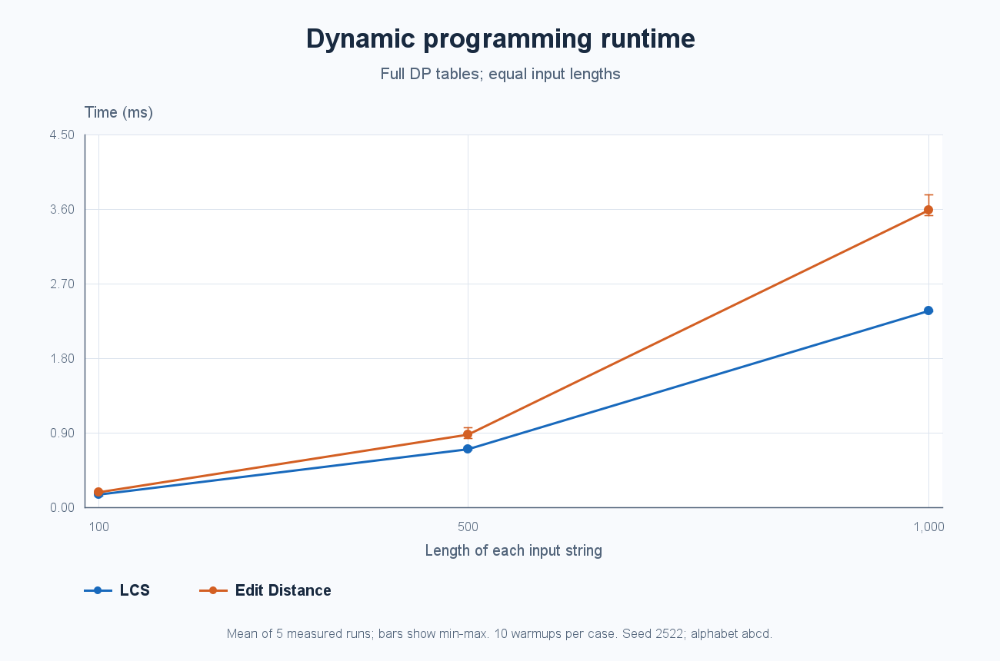
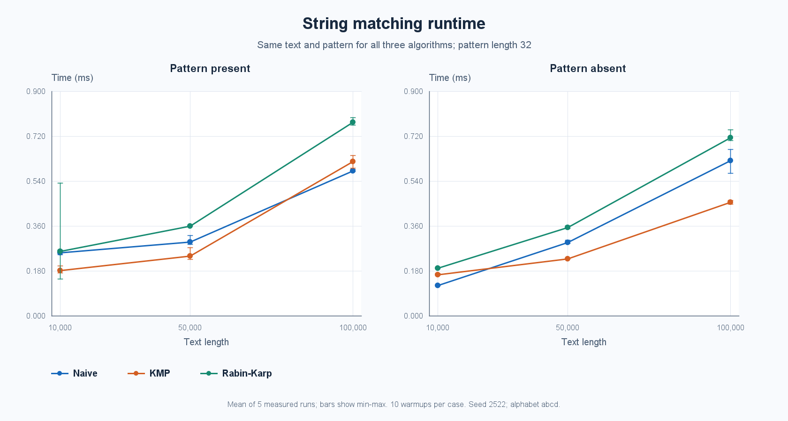
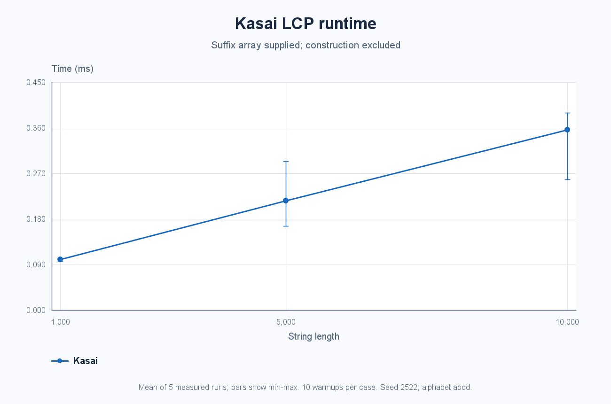

# Assignment 4: Text Analysis

**Zhuman Mukhammed | SE-2522**

This Java application implements and evaluates six text algorithms: Longest Common Subsequence (LCS), Levenshtein edit distance, Naive string matching, Knuth-Morris-Pratt (KMP), Rabin-Karp, and Kasai's Longest Common Prefix (LCP) construction. LCS measures shared sequence structure, edit distance measures the cost of changing one string into another, the matchers locate exact occurrences, and LCP describes common prefixes of adjacent sorted suffixes.

This README is the full assignment report. All algorithms are implemented directly in Java; there are no external dependencies. The committed experimental results come from this implementation.

## 1. Build and run

Install a **JDK 17 or newer**. The project is compiled with `--release 17`. Only Java standard libraries are used, including AWT/ImageIO to generate PNG charts without opening a window.

From the repository folder on Windows:

```powershell
powershell -NoProfile -ExecutionPolicy Bypass -File .\run.ps1 test
powershell -NoProfile -ExecutionPolicy Bypass -File .\run.ps1 demo
powershell -NoProfile -ExecutionPolicy Bypass -File .\run.ps1 benchmark
```

`run.ps1` checks `JAVA_HOME`, then `javac` on `PATH`, then JDK installations under `%USERPROFILE%\.jdks`. It compiles all Java files into `build/classes`. `compile` builds only; `all` runs tests, the demo, and the benchmark. A nonzero exit signals failure. To preserve the committed measurement snapshot while collecting a new run:

```powershell
powershell -NoProfile -ExecutionPolicy Bypass -File .\run.ps1 benchmark -OutputDirectory build/new-results
```

Equivalent commands with a JDK on `PATH` in a POSIX shell:

```sh
mkdir -p build/classes
find src -name '*.java' > build/sources.txt
javac --release 17 -encoding UTF-8 -Xlint:all -d build/classes @build/sources.txt
java -cp build/classes textanalysis.TestSuite
java -cp build/classes textanalysis.Main
java -Djava.awt.headless=true -cp build/classes textanalysis.experiments.Benchmark
```

The demo prints LCS length `4` for `AGGTAB`/`GXTXAYB`, edit distance `3` for `kitten`/`sitting`, matching indices `[1, 3, 5]` for `bananana`/`ana`, and the manually verified `banana` LCP array.

```text
src/main/java/textanalysis/
  Main.java                  Small examples of all required algorithms
  algorithms/                Algorithms and immutable result records
  experiments/               Benchmark runner and PNG chart generation
src/test/java/textanalysis/
  TestSuite.java              Fixtures, independent oracles and stress tests
results/
  raw.csv                    All 135 individual timed measurements
  summary.csv                Means, ranges, standard deviations and counters
  inputs.csv                 Seeds, input fingerprints and match counts
  environment.txt            Runtime and timing methodology
  verification.txt           Recorded correctness result
  *-runtime.png              Three experimental plots
run.ps1                      Windows build/run entry point
```

## 2. Implementation decisions and assumptions

- Strings are case sensitive. Positions, lengths, comparisons, and suffix ordering use Java **UTF-16 code units**, not Unicode code points or grapheme clusters. No normalization is applied.
- Matching returns every zero-based starting index in increasing order, including overlapping occurrences. The empty pattern matches every boundary `0..text.length()`, including `[0]` in an empty text. A pattern longer than the text has no matches.
- LCS returns the subsequence length. Edit distance uses cost one for insertion, deletion, and substitution; matching equal characters costs zero. Transposition is not a separate edit.
- Both DP algorithms allocate the complete `(m+1) x (n+1)` integer table, as required. They return a numeric answer and the number of interior cell updates.
- Null inputs are rejected with `NullPointerException`. Kasai rejects an incorrect suffix-array length, duplicate indices, or out-of-range indices with `IllegalArgumentException`.
- Kasai requires a lexicographically sorted suffix array containing every starting position exactly once. It checks the permutation in linear time; sortedness is a caller precondition. The simple `SuffixArrays` helper supplies sorted arrays for generated data and runs outside the measured region.
- Result lists and LCP arrays are defensively copied. The methods do not modify their supplied strings or suffix arrays.

## 3. Algorithms and correctness

### LCS

Let `L[i][j]` be the LCS length of the first `i` characters of `a` and first `j` characters of `b`.

```text
L[0][j] = L[i][0] = 0
If a[i-1] == b[j-1]: L[i][j] = 1 + L[i-1][j-1]
Otherwise:           L[i][j] = max(L[i-1][j], L[i][j-1])
```

An empty prefix has no nonempty common subsequence. When the final characters agree, an optimal common subsequence can end with that shared character; removing it leaves the smaller prefix problem. When they differ, a common subsequence must omit at least one of those final characters, so the best answer is the maximum of the two possibilities. Filling rows from shorter prefixes to longer prefixes ensures every dependency is already correct. Induction over prefix lengths therefore gives the correct final value `L[m][n]`.

### Edit distance

Let `D[i][j]` be the minimum cost of changing the first `i` characters of `a` into the first `j` characters of `b`.

```text
D[i][0] = i; D[0][j] = j
D[i][j] = min(D[i-1][j] + 1,                  deletion
              D[i][j-1] + 1,                  insertion
              D[i-1][j-1] + substitutionCost) substitution or match
substitutionCost = 0 if a[i-1] == b[j-1], otherwise 1
```

Transforming a prefix to empty requires deleting all its characters, and producing a prefix from empty requires inserting them. Every optimal transformation ends with one of the three listed actions, each following an optimal solution to a smaller prefix problem. Taking the minimum covers all possible final actions. The base cases and increasing-prefix evaluation establish correctness by induction.

### Naive, KMP and Rabin-Karp matching

**Naive** tries every candidate start `0..n-m`. It compares characters from left to right until a mismatch or a full match. Every possible occurrence is considered, so no valid starting position is skipped.

**KMP** first builds the LPS/prefix table: `prefix[i]` is the length of the longest proper prefix of `pattern[0..i]` that is also its suffix. During search, `matched` describes the pattern prefix already matched against the text. On a mismatch, `prefix[matched-1]` retains the longest viable overlap instead of moving the text index backwards and restarting. The same fallback after a full match preserves overlapping occurrences. Text advances at most `n` times, and fallback decreases progress previously gained, giving a linear total number of comparisons.

**Rabin-Karp** computes a polynomial hash with base `257` and modulus `1,000,000,007`. It removes the outgoing character's highest-power contribution, multiplies by the base, and adds the next character. This updates a window hash in constant time. A matching hash is only a candidate: the implementation compares all characters before accepting it, so a collision cannot create a false occurrence. Intermediate products fit in Java `long` for these constants and UTF-16 values. Equal substrings always have equal hashes, so checking every window also avoids missed occurrences.

### Kasai's LCP algorithm

For suffix array `sa`, `lcp[0] = 0`; for `r > 0`, `lcp[r]` is the number of equal leading characters of suffixes starting at `sa[r-1]` and `sa[r]`. An inverse array `rank` locates each text suffix in sorted order. Kasai processes suffix starts in text order and reuses a known common-prefix length `h`. Removing the first character from two matching prefixes leaves at least `h-1` matching characters; the lexicographic predecessor of the next suffix cannot have a smaller common prefix than this lower bound. The algorithm starts there, extends by direct comparison, stores the exact length, and decreases `h` by at most one for the next iteration. For the first-ranked suffix, it stores zero and resets `h`.

Manual example for `banana`:

| Rank | Suffix start | Suffix | LCP with previous suffix |
| ---: | ---: | --- | ---: |
| 0 | 5 | `a` | 0 |
| 1 | 3 | `ana` | 1 |
| 2 | 1 | `anana` | 3 |
| 3 | 0 | `banana` | 0 |
| 4 | 4 | `na` | 0 |
| 5 | 2 | `nana` | 2 |

Thus `sa = [5, 3, 1, 0, 4, 2]` and `lcp = [0, 1, 3, 0, 0, 2]`.

## 4. Complexity analysis

For DP, `m` and `n` are the two input lengths. For matching, `n` is text length, `m` is pattern length, `k` is the number of occurrences, and `w = n-m+1`. Matching bounds below assume `1 <= m <= n`. Auxiliary space excludes the returned occurrence list; add `O(k)` space for that output. All bounds describe algorithms, not measured milliseconds.

| Algorithm | Main operation | Preprocessing | Best-case time | Worst-case time | Auxiliary space and justification |
| --- | --- | --- | --- | --- | --- |
| LCS | Diagonal + 1, or max of upper/left cells | Initialize DP table | `Theta(mn)` | `Theta(mn)` | `Theta(mn)` for positive lengths: fill and retain every cell |
| Edit distance | Minimum of deletion, insertion, substitution/match | Initialize DP boundaries | `Theta(mn)` | `Theta(mn)` | `Theta(mn)` for positive lengths: fill and retain every cell |
| Naive | Compare pattern at every candidate start | `O(1)` | `Theta(w)` search | `Theta(w*m)` search | `O(1)` working state; best case fails at the first character of each window |
| KMP | Prefix-table fallback; text index never moves backwards | `Theta(m)` | `Theta(n+m)` total | `Theta(n+m)` total | `O(m)` prefix table; search is `Theta(n)` and total fallbacks are linear |
| Rabin-Karp | Rolling window hash and exact verification | `Theta(m)` | `Theta(m+w)` total | `Theta(m+w*m)` total | `O(1)` working state; hash updates are constant time but each candidate may need `m` comparisons |
| Kasai | Inverse ranks and reuse of `h-1` | `Theta(n)` validation/ranks | `Theta(n)` | `Theta(n)` | `O(n)` rank, validation and LCP arrays; successful extensions and failed comparisons total `O(n)` |

The exact DP table size is `Theta((m+1)(n+1))`; this formulation also covers empty inputs. Initialization/allocation still takes space and time when one dimension is zero, although the interior-update counter is zero. There is no early shortcut for identical inputs.

Rabin-Karp's expected time is `O(n+m)` on inputs with few genuine matches and rare hash collisions. More precisely, total work is `O(n+m+V)`, where `V` is the number of character comparisons used to verify hash hits. Under a uniform-hash assumption, expected verification work is bounded by `O(k*m + w*m/q)` for modulus `q`. This fixed deterministic hash does not guarantee that assumption on adversarial input. Even without collisions, a repetitive text and pattern can require `Theta(w*m)` verification because every genuine occurrence must be checked.

For an empty pattern, all matchers take `Theta(n+1)` time and output space to list all boundaries, with zero character comparisons. When `m > n`, they return immediately in `O(1)`. The suffix-array helper uses handwritten mergesort with direct suffix comparisons: worst-case `O(n^2 log n)` time and `O(n)` auxiliary space. That construction cost is separate from Kasai's linear bound and is excluded from its timing.

## 5. Testing strategy and results

The dependency-free test suite uses explicit checks that always execute; Java's `-ea` flag is not needed. A failed check throws an assertion error and ends the process with a failure exit code.

**Verified result: `PASS: 200935 checks`.** See [verification.txt](results/verification.txt).

| Area | Coverage and independent reference |
| --- | --- |
| LCS fixtures | Identical, completely different, either/both empty, a subsequence that is not a substring, case sensitivity and UTF-16 |
| LCS exhaustive checks | All 16,129 pairs of binary strings of lengths 0 through 6; compare with subsequence enumeration, independently of the DP recurrence |
| Edit distance fixtures | Identical, empty, substitution, insertion, deletion, mixed edits and transposition |
| Edit distance exhaustive checks | All 961 pairs of binary strings of lengths 0 through 4; compare with BFS over actual unit-cost edit operations |
| Matching fixtures | Beginning, middle, end, multiple/overlapping matches, absence, longer pattern, empty pattern/text, prefix fallback, NUL and high UTF-16 characters |
| Matching randomized checks | 2,000 seeded cases; all three algorithms must agree with each other and with an independent `startsWith`-based reference |
| Collision handling | Two different length-two strings have the same base-257 hash; Rabin-Karp must verify and reject the collision |
| Kasai fixtures | Manually supplied `banana` suffix/LCP arrays; empty, singleton, repeated and distinct characters |
| Suffix/LCP randomized checks | 1,000 seeded cases; compare suffix ordering with a test-only library sort and each LCP with direct prefix comparison |
| Contracts and stress | Null inputs, malformed suffix arrays, immutable outputs, 10,000-character repetitive inputs, linear comparison bounds |

Library operations used by test oracles and input preparation do not replace any required algorithm implementation. DP cell counts, Rabin-Karp window counts and deterministic result/counter consistency are also checked.

## 6. Experimental setup

Measurements were collected on **6 November 2026**, using **OpenJDK 25.0.1**, targeting Java 17, on **Windows 11 amd64**, with **16 available logical processors**. The runtime reported a maximum JVM heap of 4,192,206,848 bytes. Full details are in [environment.txt](results/environment.txt).

| Experiment | Input sizes | Shared input policy |
| --- | --- | --- |
| LCS and edit distance | Two strings of length 100, 500, 1,000 | Identical pair for both algorithms at each size |
| String matching | Text length 10,000, 50,000, 100,000; pattern length 32 | Identical text/pattern for Naive, KMP and Rabin-Karp in each scenario |
| Kasai | String length 1,000, 5,000, 10,000 | Suffix array prepared before timing |

All generated characters are independently sampled from the alphabet **`abcd`**, using `java.util.Random` and base seed **2522**. Derived seeds are `2522+n` for DP, `2522+1,000,000+n` for matching, and `2522+2,000,000+n` for Kasai. The DP generator draws the first string, then the second, from the same generator. Present matching patterns are copied from position `(n-32)/2`; absent patterns are sampled from the same alphabet until an untimed containment check confirms absence. The present/absent scenarios reuse the same text. Every present case in this run has exactly one occurrence; every absent case has zero. [inputs.csv](results/inputs.csv) records seeds and SHA-256 fingerprints so regenerated inputs can be compared.

Each of the 27 algorithm/input cases receives **10 untimed warmups and exactly 5 timed runs**, producing **135 measurements**. `System.nanoTime()` surrounds only the complete algorithm invocation. Preprocessing, internal allocations, defensive result construction, validation and operation counters are included. Input generation, suffix-array construction, result inspection, console output, file operations and PNG drawing are excluded. Results are inspected and consumed after stopping the clock, and repeated answers and counters must agree.

[raw.csv](results/raw.csv) records every trial in nanoseconds. [summary.csv](results/summary.csv) records the arithmetic mean, minimum, maximum and population standard deviation of the five times. Counters are identical across trials, so the summary lists their common value. No outliers are discarded. Plots show mean times with min-max bars, not confidence intervals.

Operation counts have different meanings and must not be added into one generic speed score:

- DP `cell_updates`: exactly `m*n` interior updates, excluding boundary initialization.
- Naive `comparisons`: every actual character equality test, including mismatches.
- KMP `comparisons`: actual character equality tests in both prefix preprocessing and search.
- Rabin-Karp `comparisons`: character verification only; `hash_checks` counts candidate-window hash equality tests. `verified_hash_hits` counts every hash hit subjected to verification, including collisions.
- Kasai `comparisons`: actual character equality tests, including failures, excluding permutation validation.

The algorithms run in fixed order within one JVM. Ten warmups reduce startup effects but do not guarantee steady state. These short, instrumented measurements are sensitive to JIT compilation, allocation, garbage collection and OS scheduling. They illustrate the required workloads rather than establishing universal rankings.

## 7. Experimental results

All table times are arithmetic means in **milliseconds**, rounded to six decimal places from the recorded nanoseconds.

### Dynamic programming

| Length of each string | LCS time (ms) | Edit distance time (ms) | Interior updates per algorithm | LCS length | Edit distance |
| ---: | ---: | ---: | ---: | ---: | ---: |
| 100 | 0.155240 | 0.185160 | 10,000 | 63 | 56 |
| 500 | 0.702760 | 0.878820 | 250,000 | 324 | 266 |
| 1,000 | 2.377300 | 3.594360 | 1,000,000 | 645 | 519 |



### String matching

| Scenario | Text length | Naive (ms) | KMP (ms) | Rabin-Karp (ms) | Occurrences |
| --- | ---: | ---: | ---: | ---: | ---: |
| Present | 10,000 | 0.252680 | 0.182460 | 0.258460 | 1 |
| Present | 50,000 | 0.295740 | 0.239260 | 0.360400 | 1 |
| Present | 100,000 | 0.581620 | 0.618080 | 0.775660 | 1 |
| Absent | 10,000 | 0.121640 | 0.165720 | 0.190740 | 0 |
| Absent | 50,000 | 0.294700 | 0.229620 | 0.354400 | 0 |
| Absent | 100,000 | 0.622520 | 0.454740 | 0.714160 | 0 |

| Scenario | Text length | Naive comparisons | KMP comparisons incl. preprocessing | RK verification comparisons | RK hash checks | RK verified hash hits |
| --- | ---: | ---: | ---: | ---: | ---: | ---: |
| Present | 10,000 | 13,406 | 12,575 | 32 | 9,969 | 1 |
| Present | 50,000 | 66,600 | 62,554 | 32 | 49,969 | 1 |
| Present | 100,000 | 133,129 | 124,915 | 32 | 99,969 | 1 |
| Absent | 10,000 | 13,380 | 12,418 | 0 | 9,969 | 0 |
| Absent | 50,000 | 66,786 | 62,549 | 0 | 49,969 | 0 |
| Absent | 100,000 | 133,226 | 124,918 | 0 | 99,969 | 0 |



### Kasai

| String length | Kasai time (ms) | Character comparisons | Maximum LCP |
| ---: | ---: | ---: | ---: |
| 1,000 | 0.099760 | 1,991 | 10 |
| 5,000 | 0.216360 | 9,989 | 11 |
| 10,000 | 0.356480 | 19,988 | 12 |



## 8. Discussion

**DP work is quadratic.** Increasing both lengths from 100 to 1,000 increases interior updates exactly 100 times, from 10,000 to 1,000,000. Measured LCS time increases about 15.3 times, and edit distance about 19.4 times. From 500 to 1,000, the updates grow fourfold; LCS time grows about 3.38 times and edit distance about 4.09 times. The counters follow the theoretical bound exactly, while runtime ratios also reflect compilation, allocation and constant overhead. Edit distance is slower than LCS at every measured size in this run; its recurrence performs more candidate arithmetic and minimum operations.

**Random text is favorable to the naive matcher.** With a four-character alphabet, many candidate windows fail immediately, so its comparison count is about `1.33*n`, far below the worst-case `w*m`. KMP uses roughly `1.25*n` comparisons including preprocessing here. KMP is faster at 50,000 characters for both scenarios and at 100,000 for the absent pattern, but Naive is faster for the 100,000 present-pattern case. Fewer comparisons therefore do not guarantee lower elapsed time in every short run. With fixed `m=32`, these experiments also cannot demonstrate how increasing pattern length changes the worst-case gap.

**Rabin-Karp minimizes character verification, not total work.** It performs only 32 verification comparisons for each present-pattern case and none for the absent cases. Nevertheless, it computes and compares 9,969 to 99,969 window hashes and performs modular arithmetic at each shift. It is the slowest matcher in these recorded means. There were no hash collisions in the timed inputs; the correctness suite separately exercises one deliberately. The 10,000-character present case has a wide timing range (0.147900 to 0.533200 ms), illustrating why the mean should be read together with its min-max bars.

**Kasai's counts support linear work.** Comparisons increase from 1,991 to 19,988 as length increases tenfold, remaining near `2*n`. Runtime increases about 3.57 times over that range, rather than exactly tenfold, because fixed overhead and JVM effects matter at sub-millisecond scales. This measures LCP construction with a supplied suffix array. It does not show that the complete suffix-array-plus-LCP pipeline is linear.

Only three sizes per family, one generated input per size/scenario, and five measurements per input were required and used. Repetitive adversarial strings are included in correctness tests, but the performance tables describe random inputs. The tables and plots should not be interpreted as proofs of asymptotic complexity or predictions for all workloads.

## 9. Conclusion

LCS and edit distance use the same quadratic table structure to answer different questions: retained sequence length versus transformation cost. Full tables make the recurrences clear but require quadratic memory. Naive matching is simple and competitive on easy random input; KMP adds prefix preprocessing to guarantee linear search even when prefixes repeat. Rabin-Karp offers constant-time rolling updates and exact verification but pays for hash arithmetic and can require quadratic verification work. Kasai efficiently reuses neighboring-prefix information to build an LCP array in linear time once a valid suffix array is available.

The project contains the six required implementations, all required edge cases, independent correctness checks, reproducible measurements, operation counts, and three PNG plots. Rerunning the benchmark regenerates CSV files and plots; this README records the committed measurement snapshot, so a replacement measurement run should also update its tables and discussion.
